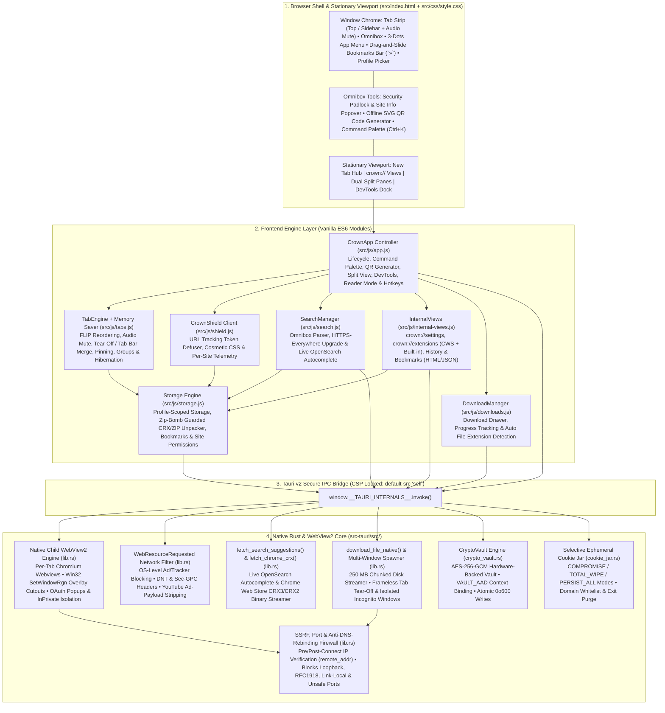
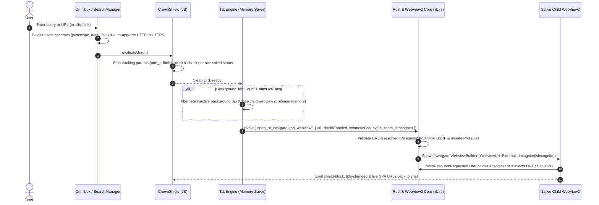

<p align="center">
  
</p>

# Crown Web Browser

Crown is an ultra-lightweight, privacy-first web browser engineered for Desktop (Windows, macOS, Linux) and Mobile (Android). Built on a native Rust core powered by Tauri v2 and modern web standards, Crown delivers native OS-level request interception, zero-flicker tab orchestration, distraction-free reading, and integrated defense telemetry while eliminating the heavy 500–800 MB multi-process overhead of standalone Chromium distributions.

---

## System Architecture

Crown separates its runtime into a lightweight, zero-framework ES6 Frontend Shell and a connection-pooled Native Rust Core (`crown_lib`) communicating over a strict Content-Security-Policy (CSP) Tauri v2 IPC bridge.

### 1. End-to-End Component Architecture



### 2. Navigation, Shield Interception & `Memory Saver` Lifecycle



---

## Key Features

### Native Child WebView2 & Memory Saver Engine
* **Real Chromium Child Webviews (No `<iframe>` Limitations)**: On desktop, every web tab runs inside a dedicated Tauri v2 child WebView2 instance (`WebviewUrl::External`) using the OS-installed WebView2 runtime. Modern JS-heavy apps, logins, OAuth popups (`Sign in with Google/GitHub`), PDFs, and `X-Frame-Options` / `CSP` sites work natively just like Chrome/Edge without bundling a 150 MB+ browser binary.
* **Win32 `SetWindowRgn` Live Overlay Cutouts**: Floating menus, Shield popovers, Site Info, QR codes, and Drawers punch exact cutout regions in the child WebView2 HWND so the live webpage stays visible behind them.
* **Native Frameless Windowing & Child WebView2 Lifecycle**: Custom frameless titlebar with native `window_start_dragging` (normal move, pull-down-from-maximized restore, and double-click maximize), Windows `AppUserModelID` (`com.crown.browser`) + `Crown.exe` binary naming, and serialized async child WebView2 lifecycle (`webview_lifecycle_lock` + `webview_url_cache`) for crash-free multi-tab navigation.
* **Memory Saver & Tab Hibernation**: Automatically hibernates inactive background tabs by closing their child webviews while preserving full tab state, pinned status, and navigation history, and restores them on focus according to your chosen policy (*Balanced* default `2` live tabs, *Moderate* `5`, or *Maximum* `1`).
* **Manual Tab Hibernation**: Right-click any background tab to immediately unload its webview via **Hibernate Tab**.
* **Distraction-Free Reader Mode (`Alt+R`)**: Strips away page scripts, ads, and layout frames on web articles using live DOM extraction. Features clean, zero-emoji typography, font family & size controls, and an atmospheric theme engine linked to your browser settings with dark, sepia, and light modes.
* **Real-Time In-Page Navigation & Full URL Sync**: Deep article and SPA navigations (`pushState`, `replaceState`, `on_document_title_changed`, `sync_tab_webview`) sync in real time to the Omnibox, per-tab back/forward history stacks, bookmarking, and offline QR code generation while preserving complete URL paths.

### Crown Shield Guard & Cloudflare-Grade Security Hardening
* **WebView2 `WebResourceRequested` Network Interception & Anti-Adblock Shims**: Outbound subresource requests (`<script>`, ``, `<iframe>`, `fetch`, `XHR`, beacons) are intercepted at the native WebView2 network layer (`ICoreWebView2::AddWebResourceRequestedFilter`) using `ShieldRuntimeState` synced from `shield.js`, serving valid `application/javascript` redirect shims (`shield_mock_response_for_url` / `StaticBytesStream` for `ad_status.js` and `adsbygoogle.js`) alongside `DNT: 1` and `Sec-GPC: 1` header injection, YouTube ad/enforcement payload stripping (`adPlacements`, `playerAds`, `adSlots`, `enforcementMessageViewModel`, `bkaEnforcementMessageViewModel`), interruption toast suppression (`3037019`), and enforcement dialog dismissal with safe playback auto-resume.
* **Comprehensive IPv4/IPv6 SSRF, Port Firewall & Post-Connect Anti-DNS-Rebinding**: Blocks loopback, RFC 1918 private networks, RFC 6598 shared space, cloud metadata (`169.254.169.254`), IPv4-mapped IPv6 (`::ffff:0:0/96`), IPv6 Unique Local (`fc00::/7`), and Link-Local (`fe80::/10`) across **every intermediate HTTP redirect hop** AND verifies the post-connect socket `remote_addr()` to defeat DNS-rebinding attacks, alongside a native port firewall (`is_unsafe_network_port`) blocking unsafe protocol ports (SSH 22, SMTP 25, DNS 53, Redis 6379, Memcached 11211, MongoDB 27017, MySQL 3306, PostgreSQL 5432).
* **Hardware-Backed AES-256-GCM Local Vault (`crypto_vault.rs`)**: Encrypts saved credentials locally using `ring` AES-256-GCM with 96-bit CSPRNG nonces, Additional Authenticated Data (`VAULT_AAD`) context binding, Windows DPAPI master-key sealing (`CROWN-DPAPI-V1:`), `ZeroizeOnDrop` memory wiping, poison-safe concurrency, atomic file writes, and zero plaintext `localStorage` fallback in Tauri runtime.
* **Selective Ephemeral Cookie Jar (`cookie_jar.rs`)**: Configurable cookie retention modes (`COMPROMISE` whitelist-based default, `TOTAL_WIPE` ephemeral session-only, and `PERSIST_ALL`), domain-level cookie inspection, and automatic purge on browser exit.
* **Streaming Memory Caps & Anti-Zip-Bomb Guard**: Enforces a fast `Content-Type` check and a strict `5 MB` streaming chunk limit on HTML responses, `250 MB` chunked disk streaming on downloads, and a chunked `512 KB` decompression ceiling when unpacking `.crx`/`.zip` extension archives.
* **Sub-Resource Ad & Tracker Blocker**: Injects an in-page `fetch` and `XMLHttpRequest` interceptor alongside cosmetic CSS filtering to block third-party ad networks, analytics beacons, and cookie consent barriers.
* **Tracking Parameter Defuser & HTTPS-Everywhere**: Automatically strips privacy-invasive URL parameters (`utm_*`, `fbclid`, `gclid`, `mc_eid`) and upgrades insecure `http://` navigations to `https://`.
* **Dynamic Omnibox Security Padlock, Site Info Popover & Offline SVG QR Code Generator**: Real-time visual indicator distinguishing encrypted `HTTPS` connections, unencrypted `HTTP` warnings, and internal `crown://` routes. Includes a 100% local ISO/IEC 18004 SVG QR Code generator in the address bar to share any page URL to mobile devices without network calls.

### Zero-Flicker Tab & Layout Engine
* **Dual Tab Orientations**:
  * **Top Horizontal Tabs**: Classic pill layout with comfortable spacing, smooth active indicators, and pointer-driven drag-and-drop reordering.
  * **Left Vertical Sidebar Tabs**: Space-efficient vertical tree, toggleable between a full 230px expanded view and a 54px compact icon rail.
* **Tab Audio Mute & Extended Context Menu**: Real-time media playback indicator (`.tab-audio-btn`) on tabs with 1-click mute/unmute, plus context menu actions for *Mute/Unmute Site*, *Close Other Tabs*, *Close Tabs to the Right*, *Duplicate Tab*, *Pin Tab*, and *Hibernate Tab*.
* **Instant Command Palette (`Ctrl+K`)**: Spotlight-style modal (hidden by default for zero toolbar clutter) to fuzzy-search open tabs, hibernated tabs, bookmarks, recent history, and quick browser commands.
* **Chrome-Style Tab Drag Tear-Off & Tab-Bar Window Merge**:
  * **Tear-Off into New Window**: Dragging a tab downward out of the horizontal tab strip (or outward from the vertical sidebar) detaches it into a floating ghost pill and spawns a new Crown window at the cursor coordinates carrying that tab.
  * **Merge onto Tab Bar Only**: Dragging a tab onto **another Crown window's tab bar** (`#tab-bar` or `#sidebar-tab-list` — strictly never merging if dropped on the webpage viewport) highlights the target tab strip and merges the tab into that window at the hovered slot (auto-closing the source window if it was the last tab).
* **Tailored 3-Dots (`⋮`) Crown App Menu & Conditional Omnibox Zoom**:
  * Top-right application menu providing instant access to `New tab`, `New window` (`Ctrl+N`), `New private session` (`Ctrl+Shift+N`), inline `Sidebar Tabs` mode switcher (`On` | `Compact` | `Off`), `Split View` (`Ctrl+Shift+S`), `History`, `Bookmarks`, `Downloads`, `Extensions`, `Delete browsing data...`, inline `Zoom` controls (`−` | `100%` | `+` | `Fullscreen F11`), `Print...` (`Ctrl+P`), `Find in page...`, `Reader Mode`, `Developer Tools`, `About Crown`, `Settings`, and `Exit`.
  * **Chrome-Style Conditional Zoom Indicator**: On desktop, the omnibox zoom badge (`#omnibox-zoom-btn`) stays hidden at `100%` and appears whenever the page is zoomed (`Ctrl++` / `Ctrl+-` / `Ctrl+Wheel`), opening a compact popover with `−`, live `%`, `+`, and `Reset` controls (hidden on mobile where native pinch-to-zoom applies).
* **Ephemeral Site Permissions (`Allow this time`)**: Site Info (`🔒`) and `crown://settings` support `Ask`, `Allow`, `Allow this time` (`allow-once` per session), and `Block` for Camera, Microphone, Location, and Notifications.
* **Pinned Tabs & Context-Aware Middle-Click**:
  * Pin essential tabs into compact icon-only pills locked at the start of the tab strip (protected from accidental `Ctrl+W` or middle-click closure).
  * **Middle-Click on Tab Strip**: Closes the clicked tab in the tab bar.
  * **Middle-Click (Scroll-Click) or `Ctrl+Click` on Links**: Opens any website hyperlink, search result, bookmark, or history entry in a new tab.
  * **Middle-Click (Scroll-Click) on Page Body**: Activates smooth mouse-movement auto-scrolling (move mouse up to scroll up, move mouse down to scroll down).
* **Interactive Side-by-Side Split View (`Ctrl+Shift+S`)**:
  * Multitask with two tabs simultaneously side-by-side with a draggable resize divider (20% to 80%).
  * **Untouched Left Pane**: Preserves the active tab as-is (webpages, `crown://newtab` dashboard, or `crown://*` internal views without forcing external search engines).
  * **Interactive Second-Screen Picker (`#split-secondary-picker`)**: Displays an in-pane tab and URL chooser showing open tabs, an in-pane search/URL input, and your favorite shortcuts & bookmarks.
  * **Floating Split Control Pill**: 1-click **Swap Panes (`⇄`)**, **Switch Right Tab (`⊞`)**, and **Exit Split View (`✕`)**, with an active pane indicator that syncs the Omnibox.
* **Built-In Developer Tools Inspector (`Ctrl+Shift+I` / `F12`)**:
  * Docked Developer Tools drawer featuring **Elements** (live DOM tree serializer & node metrics), **Console** (sandboxed JavaScript evaluator inside the active frame), **Network & Shield** (real-time allow/block request log), and **Memory & Storage** (tab hibernation & profile storage telemetry).
* **CPU & GPU Zero-Flicker FLIP Animations**: In-place DOM reconciliation and 2D integer-rounded FLIP transitions ensure buttery-smooth tab and bookmark drag reordering even on systems without hardware GPU acceleration.
* **Color-Coded Tab Grouping**: Organize related tabs into labeled groups with an in-app group editor, customizable color swatches, and collapsible accordion pills.
* **Per-Profile Session Restore & `Ctrl+Shift+T`**: Automatically saves and restores open tabs, pinned states, and tab groups per profile (with background tabs restored in a hibernated state) and reopens closed tabs via `Ctrl+Shift+T`.

### Live Multi-Provider Search & Omnibox Autocomplete
* **100% Live OpenSearch Suggestions**: Real-time search query completions (`fetch_search_suggestions` supporting Google, DuckDuckGo, Brave Search, and Bing OpenSearch APIs) combined with local Bookmarks and Browsing History in **both** the top Omnibox Address Bar and the New Tab Search Box.
* **Full Keyboard Navigation**: Supports `ArrowDown`, `ArrowUp`, `Enter`, and `Escape` across all suggestion lists.

### Multi-Profile System & Startup Picker
* **"Who's using Crown?" Startup Profile Picker**:
  * **Automatic Single-Profile Bypass**: When only 1 profile exists, Crown opens directly into the browser workspace without delay.
  * **Multi-Profile Startup Hub**: When 2 or more profiles exist, Crown presents a minimalist, professional dark-mode profile picker to select, create, edit, or delete profiles.
  * **Startup Toggle & Guest Mode**: Includes a **"Show on startup"** checkbox (when unchecked, Crown opens directly into the last active profile) and a 1-click **Guest mode** button.
* **Complete State Isolation**: Scopes bookmarks, history, shortcuts, tab groups, session tabs, and theme settings per profile.

### Dedicated Internal Views (`crown://`), Extensions & Local Data Portability
* **`crown://settings` (`Ctrl+,`)**: Full browser settings suite with live search filtering and immediate hot-reload across **System** (`Memory Saver` *Moderate / Balanced / Maximum* + active site whitelist & `Power / Energy Saver` battery policies), **Appearance** (accent colors, 5 backdrop presets + custom image URL/upload, tab layout, bookmarks bar, default zoom), **Shields & Privacy** (selective ephemeral cookie policies, hardware-backed local password vault, stored site data manager, `HTTPS-Only` & `Sec-GPC: 1`), **Site Settings** (default and per-site Camera, Microphone, Location, Notifications, JavaScript, and Popups), **On startup** (`newtab`, `continue` restore session, `custom` URL), **Search Engine**, **Extensions**, **Languages** (`Accept-Language` & spellcheck), **Downloads** (destination prompt toggle), **Accessibility** (High-Contrast, Reduced Motion, Minimum Font Size), **Reset Settings**, and **About Crown**.
* **`crown://extensions`**: Supports installing extensions directly from the **Chrome Web Store** (by pasting a Chrome Web Store URL, entering a 32-character Extension ID, or uploading a `.crx` / `.zip` package using native CRX3/CRX2 header parsing and `DecompressionStream('deflate-raw')` manifest extraction), alongside 5 built-in extensions (*Universal Dark Reader*, *Popup & Annoyance Skipper*, *Media & Cinema Enhancer*, *JSON & Code Prettifier*, *ClearType Reading Boost*) and a custom CSS/Userscript installer.
* **`crown://newtab`**: Customizable start page featuring live search autocomplete, a Brave-style **8-per-page (4×2) paginated shortcuts & auto-frequent sites grid** (zero hardcoded default bookmarks or shortcuts, exact-link deduplication preserving distinct subdomains), Crown Shield Guard telemetry, and custom wallpapers.
* **`crown://history`**: Chronological browsing timeline with real-time search filtering, dynamic site favicons, date-grouped entries, single-item deletion, and an **In-App Clear Browsing Data Modal** with time-range selection.
* **`crown://bookmarks`**: Visual bookmark manager with **Netscape HTML (`bookmarks.html`) & JSON Export/Import**, inline bookmark editing, right-click context menus, and pointer **drag-and-slide reordering** across both the **Bookmarks Bar** and the automatic Chrome-style overflow (`»`) menu.
* **Native OS Download Manager**: Streams files directly to the host OS `Downloads` directory (`download_file_native`) with automatic collision-safe naming (`file (1).ext`) so existing files are never overwritten.

---

### Essential Keyboard Shortcuts

| Shortcut | Action |
| :--- | :--- |
| `Ctrl + K` | Open Instant Command Palette & Tab/Bookmark Search |
| `Ctrl + T` | Open new tab |
| `Ctrl + N` | Open new Crown window |
| `Ctrl + Shift + N` | Open dedicated Incognito window |
| `Drag Tab Down / Out` | Tear tab off into a new Crown window |
| `Drag Tab onto Another Window's Tab Bar` | Merge tab into target window's tab bar |
| `Ctrl + W` / `Middle-Click Tab` | Close tab (Pinned tabs are protected) |
| `Middle-Click Link` / `Ctrl + Click` | Open hyperlink, search result, or bookmark in a new tab |
| `Middle-Click Page` (Scroll-Click) | Toggle mouse-movement auto-scroll (move mouse up/down to scroll) |
| `Ctrl + Shift + S` | Toggle Side-by-Side Split View |
| `Ctrl + Shift + I` / `F12` | Toggle Developer Tools Inspector |
| `Ctrl + ,` | Open Settings (`crown://settings`) |
| `Ctrl + P` | Print active page |
| `F11` | Toggle Fullscreen |
| `Ctrl + Shift + T` | Reopen last closed tab |
| `Ctrl + Tab` / `Ctrl + Shift + Tab` | Cycle next / previous tab |
| `Ctrl + 1` .. `Ctrl + 8` | Jump to tab 1–8 (`Ctrl + 9` jumps to last tab) |
| `Alt + R` | Toggle Distraction-Free Reader Mode |
| `Ctrl + L` | Focus Omnibox address bar |
| `Ctrl + D` | Bookmark current tab |
| `Ctrl + R` | Reload active page |
| `Ctrl + F` | Open In-Page Find bar |
| `Ctrl + +` / `Ctrl + -` / `Ctrl + 0` | Zoom in (+10%) / Zoom out (-10%) / Reset zoom (100%) |
| `Alt + Left` / `Alt + Right` | Navigate Back / Forward in tab history |
| `Ctrl + H` | Open Browsing History (`crown://history`) |
| `Ctrl + J` | Toggle Downloads Drawer |

---

## Technical Specifications

| Dimension | Specification |
| :--- | :--- |
| **Desktop Platform** | Windows 10/11 (WebView2), macOS (WebKit), Linux (WebKitGTK) |
| **Mobile Platform** | Android 7.0+ (API Level 24+), Android System WebView |
| **Frontend Runtime** | Vanilla ES6+ Modules, CSS Custom Properties, Vite 5 |
| **Backend Core** | Rust 1.80+ (Tauri v2 Application Framework) |
| **Native Crate** | `crown_lib` (staticlib, cdylib, rlib) |
| **Network Engine** | Connection-Pooled `reqwest` (Rustls TLS), Custom SSRF Redirect Policy |
| **Core Distribution Size** | Under 50 KB gzipped web bundle |

---

## Repository Structure

```text
Crown/
├── src/                        # Web application frontend core
│   ├── index.html              # Main browser document, modals, QR popover & command palette shell
│   ├── css/
│   │   └── style.css           # Design system tokens, desktop/mobile responsive layouts & components
│   ├── js/
│   │   ├── app.js              # Application lifecycle, Command Palette, QR generator, Split View, DevTools
│   │   ├── tabs.js             # TabEngine + Memory Saver: FLIP animations, audio mute, pinning, groups
│   │   ├── shield.js           # Crown Shield Guard, telemetry, and URL parameter defuser
│   │   ├── internal-views.js   # Settings, Extensions, History & Bookmarks (HTML/JSON portability)
│   │   ├── downloads.js        # Download drawer, transfer progress, speed calculations
│   │   ├── search.js           # Omnibox parser, HTTPS upgrade, live OpenSearch suggest
│   │   └── storage.js          # Profile-scoped persistence layer, CRX/ZIP unpacker & Incognito guard
│   └── public/
│       ├── favicon.png         # Browser favicon
│       └── assets/
│           ├── crown-banner.svg # Flat-matte vector architectural banner
│           └── rules/          # Filter lists, adblock rules, query filter definitions
├── src-tauri/                  # Native Rust application shell
│   ├── Cargo.toml              # Rust crate manifest (`crown_lib`)
│   ├── tauri.conf.json         # Tauri v2 window parameters & strict CSP policy
│   ├── build.rs                # Native build hook
│   ├── icons/                  # Production asset suite (.ico, .icns, Android mipmaps)
│   └── src/
│       ├── lib.rs              # SSRF/Redirect/DNS-Rebinding guard, Shield proxy, OpenSearch & Downloader
│       ├── crypto_vault.rs     # Hardware-backed AES-256-GCM local credential vault
│       ├── cookie_jar.rs       # Selective ephemeral cookie policy engine
│       └── main.rs             # Application entry point
├── test/                       # Mandatory automated production unit test suite (84 JS + 14 Rust tests)
│   ├── runner.js               # Zero-dependency tabular test runner (runs on `npm run build`)
│   ├── setup.js                # Headless DOM & Web API test environment harness
│   └── unit/                   # Feature & security unit test suites
├── CROWN_DOCUMENTATION.md      # Exhaustive end-to-end technical documentation
├── LICENSE                     # MIT License
├── package.json                # Project dependencies and script definitions
├── vite.config.js              # Vite build and dev server proxy configuration
└── .gitignore                  # Git tracking exclusion rules
```

---

## Getting Started

### Prerequisites
* **Node.js**: Version 20 LTS or later
* **npm**: Version 10 or later
* **Rust Toolchain**: Stable release (`rustc` and `cargo` 1.80+)
* **Java Development Kit**: JDK 17 or JDK 21 (optional, for Android Gradle toolchains)

### Installation

```bash
# Clone the repository
git clone https://github.com/PI-Prasaad-Krishna/Crown.git
cd Crown

# Install Node dependencies
npm install
```

### Local Development

To run the browser frontend inside a hot-reloading development environment:

```bash
npm run dev
```

To launch the native desktop shell with Tauri live reloading:

```bash
npm run desktop
```

---

## Build and Packaging Pipelines

```bash
# 1. Compile and optimize the web bundle into dist/
npm run build

# 2. Generate standalone native desktop installer (.exe / .msi / .dmg / .AppImage)
npm run build:desktop

# 3. Compile Android release APK / AAB package
npm run build:android
```

---

## License

This project is licensed under the MIT License. See the [LICENSE](file:///d:/Crown/LICENSE) file for details.
