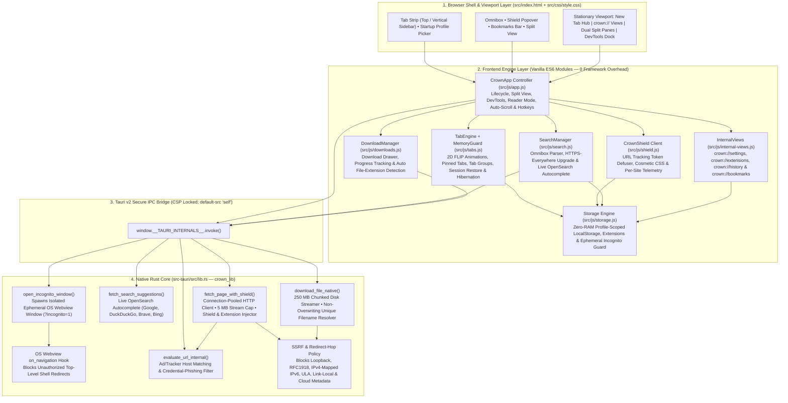
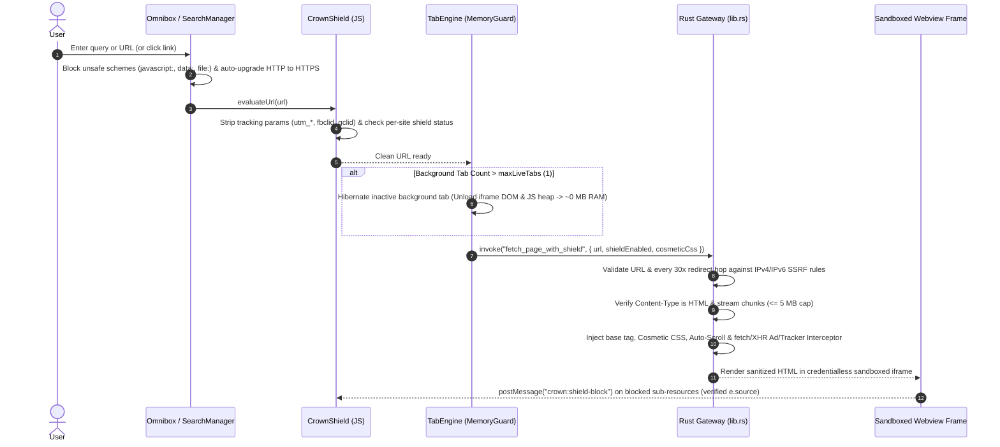

<p align="center">
  
</p>

# Crown Web Browser

Crown is an ultra-lightweight, privacy-first web browser engineered for Desktop (Windows, macOS, Linux) and Mobile (Android). Built on a native Rust core powered by Tauri v2 and modern web standards, Crown delivers native OS-level request interception, zero-flicker tab orchestration, distraction-free reading, and integrated defense telemetry while eliminating the heavy 500–800 MB multi-process overhead of standalone Chromium distributions.

---

## System Architecture

Crown separates its runtime into a lightweight, zero-framework ES6 Frontend Shell and a connection-pooled Native Rust Core (`crown_lib`) communicating over a strict Content-Security-Policy (CSP) Tauri v2 IPC bridge.

### 1. End-to-End Component Architecture



### 2. Navigation, Shield Interception & `MemoryGuard` Lifecycle



---

## Key Features

### Ultra-Low RAM Engine (`MemoryGuard`)
* **Single-Active Webview Architecture (~80–100 MB Target)**: Automatically hibernates inactive background tabs by unloading their `<iframe>` DOM and JavaScript heaps while preserving full tab state, pinned status, and navigation history.
* **Instant Wake-on-Focus**: Switching to a sleeping tab seamlessly restores its session while putting the previous background tab to sleep.
* **Manual Tab Hibernation**: Right-click any background tab to immediately free its memory via **Hibernate Tab (Free RAM)**.
* **Distraction-Free Reader Mode (`Alt+R`)**: Strips away page scripts, sidebars, and third-party layout frames on web articles, presenting clean typography on a matte dark canvas while cutting active tab memory usage by up to 80%.

### Crown Shield Guard & Security Hardening
* **OS-Level & Gateway Request Interception**: Outbound requests are evaluated in the native Rust backend (`on_navigation` and `fetch_page_with_shield` hooks) using persistent connection-pooled HTTP clients.
* **Comprehensive IPv4/IPv6 SSRF & Redirect-Hop Protection**: Blocks loopback, RFC 1918 private networks, RFC 6598 shared space, cloud metadata (`169.254.169.254`), IPv4-mapped IPv6 (`::ffff:0:0/96`), IPv6 Unique Local (`fc00::/7`), and Link-Local (`fe80::/10`) across **every intermediate HTTP redirect hop**.
* **Streaming Memory Caps**: Enforces a fast `Content-Type` check and a strict `5 MB` streaming chunk limit on HTML responses and `250 MB` chunked disk streaming on downloads to prevent Out-Of-Memory (OOM) Denial-of-Service attacks.
* **Sub-Resource Ad & Tracker Blocker**: Injects an in-page `fetch` and `XMLHttpRequest` interceptor alongside cosmetic CSS filtering to block third-party ad networks, analytics beacons, and cookie consent barriers.
* **Tracking Parameter Defuser & HTTPS-Everywhere**: Automatically strips privacy-invasive URL parameters (`utm_*`, `fbclid`, `gclid`, `mc_eid`) and upgrades insecure `http://` navigations to `https://`.
* **Dynamic Omnibox Security Padlock**: Real-time visual indicator distinguishing encrypted `HTTPS` connections, unencrypted `HTTP` warnings, and internal `crown://` routes.

### Zero-Flicker Tab & Layout Engine
* **Dual Tab Orientations**:
  * **Top Horizontal Tabs**: Classic pill layout with comfortable spacing, smooth active indicators, and pointer-driven drag-and-drop reordering.
  * **Left Vertical Sidebar Tabs**: Space-efficient vertical tree, toggleable between a full 230px expanded view and a 54px compact icon rail.
* **Pinned Tabs & Context-Aware Middle-Click**:
  * Pin essential tabs into compact icon-only pills locked at the start of the tab strip (protected from accidental `Ctrl+W` or middle-click closure).
  * **Middle-Click on Tab Strip**: Closes the clicked tab in the tab bar.
  * **Middle-Click (Scroll-Click) or `Ctrl+Click` on Links**: Opens any website hyperlink, search result, bookmark, or history entry in a new tab.
  * **Middle-Click (Scroll-Click) on Page Body**: Activates smooth mouse-movement auto-scrolling (move mouse up to scroll up, move mouse down to scroll down).
* **Side-by-Side Split View (`Ctrl+Shift+S`)**:
  * View two tabs simultaneously side-by-side (`50% / 50%` with a draggable resize divider) via the toolbar Split View button, `Ctrl+Shift+S`, or right-clicking any tab (`Open in Split View`). Clicking inside either pane automatically syncs the Omnibox and navigation controls to that tab.
* **Built-In Developer Tools Inspector (`Ctrl+Shift+I` / `F12`)**:
  * Docked Developer Tools drawer featuring **Elements** (live DOM tree serializer & node metrics), **Console** (sandboxed JavaScript evaluator inside the active frame), **Network & Shield** (real-time allow/block request log), and **Memory & Storage** (`MemoryGuard` tab hibernation & profile storage telemetry).
* **CPU & GPU Zero-Flicker FLIP Animations**: In-place DOM reconciliation and 2D integer-rounded FLIP transitions ensure buttery-smooth tab opening, closing, pinning, and drag reordering even on systems without hardware GPU acceleration.
* **Color-Coded Tab Grouping**: Organize related tabs into labeled groups with an in-app group editor, customizable color swatches, and collapsible accordion pills.
* **Per-Profile Session Restore & `Ctrl+Shift+T`**: Automatically saves and restores open tabs, pinned states, and tab groups per profile (with background tabs restored in hibernated `0 MB` state) and reopens closed tabs via `Ctrl+Shift+T`.

### Live Multi-Provider Search & Omnibox Autocomplete
* **100% Live OpenSearch Suggestions**: Real-time search query completions (`fetch_search_suggestions` supporting Google, DuckDuckGo, Brave Search, and Bing OpenSearch APIs) combined with local Bookmarks and Browsing History in **both** the top Omnibox Address Bar and the New Tab Search Box.
* **Full Keyboard Navigation**: Supports `ArrowDown`, `ArrowUp`, `Enter`, and `Escape` across all suggestion lists.

### Zero-RAM Multi-Profile System & Startup Picker
* **"Who's using Crown?" Startup Profile Picker**:
  * **Automatic Single-Profile Bypass**: When only 1 profile exists, Crown opens directly into the browser workspace without delay.
  * **Multi-Profile Startup Hub**: When 2 or more profiles exist, Crown presents a minimalist, professional dark-mode profile picker to select, create, edit, or delete profiles.
  * **Startup Toggle & Guest Mode**: Includes a **"Show on startup"** checkbox (when unchecked, Crown opens directly into the last active profile) and a 1-click **Guest mode** button.
* **Complete State Isolation**: Scopes bookmarks, history, shortcuts, tab groups, session tabs, and theme settings per profile with **0 MB** of background process overhead.

### Dedicated Internal Views (`crown://`), Extensions & Local Data Portability
* **`crown://settings` (`Ctrl+,`)**: Full browser settings suite with live search filtering across **System** (`Memory Saver` *Moderate / Balanced / Maximum* + active site whitelist & `Power / Energy Saver` battery policies), **Appearance**, **Shields & Privacy** (including `HTTPS-Only` & `Sec-GPC: 1`), **Search Engine**, **Extensions**, **Languages** (`Accept-Language` & spellcheck), **Downloads**, **Accessibility** (High-Contrast, Reduced Motion, Minimum Font Size), **Reset Settings**, and **About Crown**.
* **`crown://extensions`**: Zero-RAM Sandboxed Extensions Manager with 5 built-in lightweight extensions (*Universal Dark Reader*, *Annoyance & Overlay Zapper*, *ClearURLs Link Sanitizer*, *YouTube Sponsor & Ad Skipper*, *Bandwidth Saver: Lazy Media*) plus a custom CSS/Userscript extension installer.
* **`crown://newtab`**: Customizable start page featuring live search autocomplete, pinned + auto-frequent site shortcuts, Crown Shield Guard telemetry, and custom wallpapers.
* **`crown://history`**: Chronological browsing timeline with real-time search filtering, date-grouped entries, single-item deletion, and an **In-App Clear Browsing Data Modal** with time-range selection.
* **`crown://bookmarks`**: Visual bookmark manager with **1-Click JSON Export & Import**, paired with a dynamic **Bookmarks Bar** featuring automatic Chrome/Brave-style overflow (`»`) menu measurement.
* **Native OS Download Manager**: Streams files directly to the host OS `Downloads` directory (`download_file_native`) with automatic collision-safe naming (`file (1).ext`) so existing files are never overwritten.

---

### Essential Keyboard Shortcuts

| Shortcut | Action |
| :--- | :--- |
| `Ctrl + T` | Open new tab |
| `Ctrl + W` / `Middle-Click Tab` | Close tab (Pinned tabs are protected) |
| `Middle-Click Link` / `Ctrl + Click` | Open hyperlink, search result, or bookmark in a new tab |
| `Middle-Click Page` (Scroll-Click) | Toggle mouse-movement auto-scroll (move mouse up/down to scroll) |
| `Ctrl + Shift + S` | Toggle Side-by-Side Split View |
| `Ctrl + Shift + I` / `F12` | Toggle Developer Tools Inspector |
| `Ctrl + ,` | Open Settings (`crown://settings`) |
| `Ctrl + Shift + T` | Reopen last closed tab |
| `Ctrl + Tab` / `Ctrl + Shift + Tab` | Cycle next / previous tab |
| `Ctrl + 1` .. `Ctrl + 8` | Jump to tab 1–8 (`Ctrl + 9` jumps to last tab) |
| `Ctrl + Shift + N` | Open dedicated Incognito window |
| `Alt + R` | Toggle Distraction-Free Reader Mode |
| `Ctrl + L` | Focus Omnibox address bar |
| `Ctrl + D` | Bookmark current tab |
| `Ctrl + R` | Reload active page |
| `Ctrl + F` | Open In-Page Find bar |
| `Ctrl + +` / `Ctrl + -` / `Ctrl + 0` | Zoom in (+10%) / Zoom out (-10%) / Reset zoom (100%) |
| `Alt + Left` / `Alt + Right` | Navigate Back / Forward in tab history |
| `Ctrl + H` | Open Browsing History (`crown://history`) |
| `Ctrl + J` | Toggle Downloads Drawer |

---

## Technical Specifications

| Dimension | Specification |
| :--- | :--- |
| **Desktop Platform** | Windows 10/11 (WebView2), macOS (WebKit), Linux (WebKitGTK) |
| **Mobile Platform** | Android 7.0+ (API Level 24+), Android System WebView |
| **Frontend Runtime** | Vanilla ES6+ Modules, CSS Custom Properties, Vite 5 |
| **Backend Core** | Rust 1.80+ (Tauri v2 Application Framework) |
| **Native Crate** | `crown_lib` (staticlib, cdylib, rlib) |
| **Network Engine** | Connection-Pooled `reqwest` (Rustls TLS), Custom SSRF Redirect Policy |
| **Core Distribution Size** | Under 50 KB gzipped web bundle |

---

## Repository Structure

```text
Crown/
├── src/                        # Web application frontend core
│   ├── index.html              # Main browser document, modals, and profile picker shell
│   ├── css/
│   │   └── style.css           # Design system tokens, layouts, and components
│   ├── js/
│   │   ├── app.js              # Application lifecycle, Reader Mode, zoom, find, hotkeys
│   │   ├── tabs.js             # TabEngine + MemoryGuard: FLIP animations, pinning, groups
│   │   ├── shield.js           # Crown Shield Guard, telemetry, and URL parameter defuser
│   │   ├── internal-views.js   # History (crown://history) and Bookmarks JSON portability
│   │   ├── downloads.js        # Download drawer, transfer progress, speed calculations
│   │   ├── search.js           # Omnibox parser, HTTPS upgrade, live OpenSearch suggest
│   │   └── storage.js          # Profile-scoped persistence layer & Incognito guard
│   └── public/
│       ├── favicon.png         # Browser favicon
│       └── assets/
│           ├── crown-banner.svg # Flat-matte vector architectural banner
│           └── rules/          # Filter lists, adblock rules, query filter definitions
├── src-tauri/                  # Native Rust application shell
│   ├── Cargo.toml              # Rust crate manifest (`crown_lib`)
│   ├── tauri.conf.json         # Tauri v2 window parameters & strict CSP policy
│   ├── build.rs                # Native build hook
│   ├── icons/                  # Production asset suite (.ico, .icns, Android mipmaps)
│   └── src/
│       ├── lib.rs              # SSRF/Redirect guard, Shield proxy, OpenSearch & Downloader
│       └── main.rs             # Application entry point
├── package.json                # Project dependencies and script definitions
├── vite.config.js              # Vite build and dev server proxy configuration
└── .gitignore                  # Git tracking exclusion rules
```

---

## Getting Started

### Prerequisites
* **Node.js**: Version 20 LTS or later
* **npm**: Version 10 or later
* **Rust Toolchain**: Stable release (`rustc` and `cargo` 1.80+)
* **Java Development Kit**: JDK 17 or JDK 21 (optional, for Android Gradle toolchains)

### Installation

```bash
# Clone the repository
git clone https://github.com/PI-Prasaad-Krishna/Crown.git
cd Crown

# Install Node dependencies
npm install
```

### Local Development

To run the browser frontend inside a hot-reloading development environment:

```bash
npm run dev
```

To launch the native desktop shell with Tauri live reloading:

```bash
npm run desktop
```

---

## Build and Packaging Pipelines

```bash
# 1. Compile and optimize the web bundle into dist/
npm run build

# 2. Generate standalone native desktop installer (.exe / .msi / .dmg / .AppImage)
npm run build:desktop

# 3. Compile Android release APK / AAB package
npm run build:android
```

---

## License

This project is licensed under the MIT License. See the [LICENSE](file:///d:/Crown/LICENSE) file for details.
